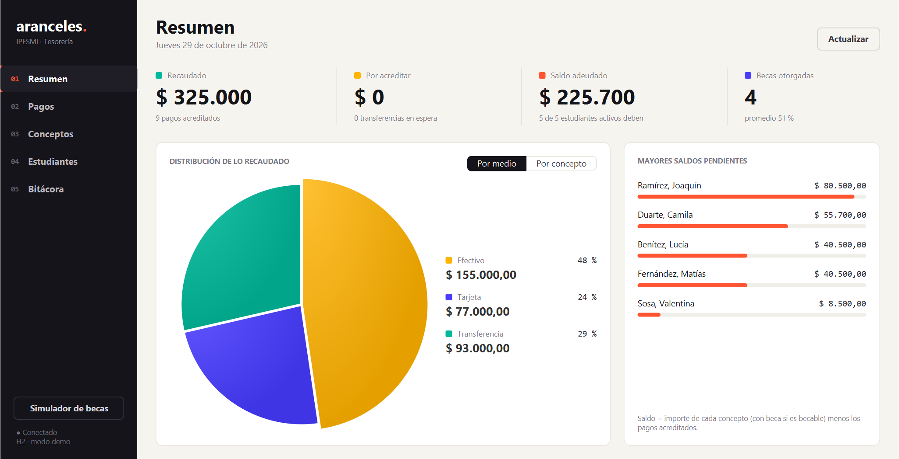

# Sistema de Gestión de Pagos y Aranceles

Programación III · IPESMI · 2026 · Parcial 2, **Actividad 7**

Aplicación de escritorio JavaFX + JPA (Hibernate) que administra conceptos de pago (matrícula, cuotas, exámenes), pagos de estudiantes en efectivo, tarjeta o transferencia, saldos pendientes y becas.



## Tecnologías

| Unidad | Qué se usó |
|---|---|
| 4 | Excepciones propias (`PagoDuplicadoException`, `MontoInvalidoException`, `BecaNoAplicableException`), `HashMap<Integer, Estudiante>`, `ArrayList<Pago>` |
| 5 | Formulario Swing *Simulador de becas* (BorderLayout, GridBagLayout, GridLayout, FlowLayout y eventos) |
| 6 | JavaFX con FXML (MVC), TableView, TreeView, PieChart, CSS propio y animaciones |
| 7 | JPA con Hibernate 6: entidades, herencia `SINGLE_TABLE`, `EntityManager`, CRUD y consultas JPQL |
| 8 | Logger Singleton, `PagoFactory` y 78 pruebas JUnit 5 |

Java 21 · Maven · MySQL 8/9 · H2 (pruebas y modo demo)

## Cómo ejecutar

1. Ejecutar `sql/pagos_aranceles.sql` en MySQL (crea la base `pagos_aranceles` con datos de ejemplo).
2. Copiar `config/db.properties.ejemplo` como `config/db.properties` y completar usuario y contraseña.
3. Ejecutar:

```bash
mvn javafx:run
```

Sin MySQL (base H2 local con los mismos datos de ejemplo):

```bash
mvn compile exec:java -Dpagos.demo=true
```

Pruebas unitarias:

```bash
mvn test
```

## Estructura

```
src/main/java/com/ipesmi/pagos
├── App.java / Main.java      arranque JavaFX
├── model/                     entidades JPA (Estudiante, Concepto, Pago y subclases)
├── dao/                       JPAUtil + DAOs con JPQL
├── service/                   reglas de negocio, saldos y becas
├── factory/                   PagoFactory (efectivo, tarjeta, transferencia)
├── exception/                 excepciones de negocio
├── util/                      LoggerTransacciones (Singleton) y formatos
├── controller/                controladores de las vistas FXML
├── view/                      animaciones, celdas y avisos
└── swing/                     simulador de becas en Swing
src/main/resources/…/view      vistas FXML
src/main/resources/…/css       hoja de estilos
sql/                           script SQL
docs/                          informe técnico, checklist y capturas
```

El log de transacciones se guarda en `logs/transacciones.log`.
